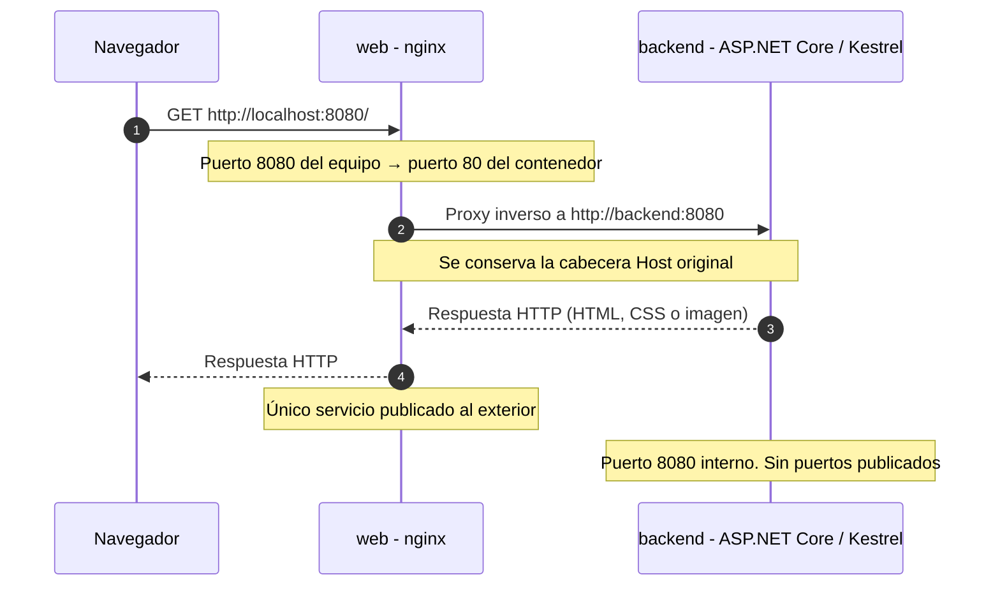

# NovaHarvest

## 1.Arranque
Requisitos
- Con Docker: tener Docker instalado y en ejecución, con Docker Compose disponible.
- Sin Docker: tener instalado el SDK de .NET 10.

### Ejecutar con Docker
Abre una terminal en la carpeta raíz del repositorio, donde se encuentra compose.yaml, y ejecuta:
```bash
docker compose up -d --build
```

Este comando construye las imágenes de web y backend y arranca los dos servicios en segundo plano. La opción --build vuelve a construir las imágenes antes de iniciar los contenedores.

Abre la aplicación en el navegador:
- Inicio: http://localhost:8080/
- Acerca de: http://localhost:8080/about
- Estado del servidor: http://localhost:8080/status

Para detener y eliminar los contenedores y la red creada por Compose:
```bash
docker compose down
```

### Ejecutar sin Docker (dotnet run)
Entra en la carpeta del proyecto ASP.NET Core:
```bash
cd backend/NovaHarvest.Web
```
Ejecuta la aplicación usando:
```bash
dotnet run
```
Abre en el navegador las siguientes direcciones:
- Inicio: http://localhost:5270/
- Acerca de: http://localhost:5270/about
- Estado del servidor: http://localhost:5270/status

Para detener la aplicación, vuelve a la terminal donde se está ejecutando y pulsa Ctrl + C.

## 2.Arquitectura
La aplicación se organiza en dos servicios que se ejecutan en contenedores Docker: web y backend.

### Diagrama de arquitectura


### Flujo de una petición
- El navegador solicita un recurso mediante http://localhost:8080/
- Docker dirige la petición al puerto 80 del contenedor web (donde está nginx)
- nginx no sirve los ficheros directamente. Reenvía la petición a http://backend:8080 y conserva la cabecera Host
- La petición llega al puerto 8080 del contenedor backend. Kestrel ejecuta la aplicación ASP.NET CORE y genera la respuesta.
- La respuesta vuelve a nginx y este la envía al navegador