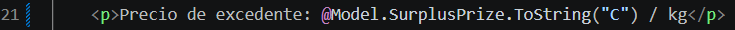
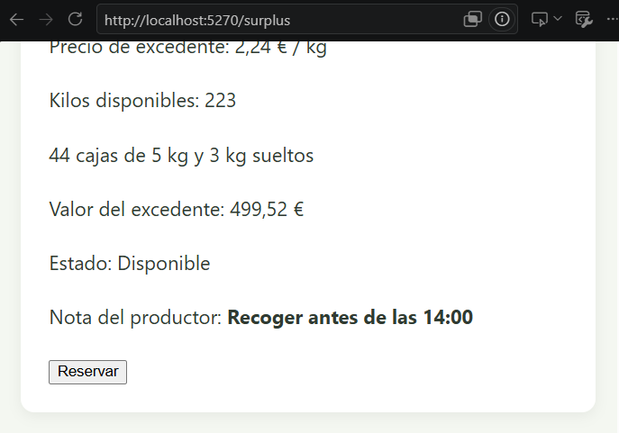
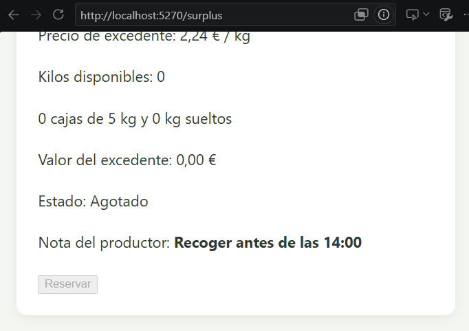
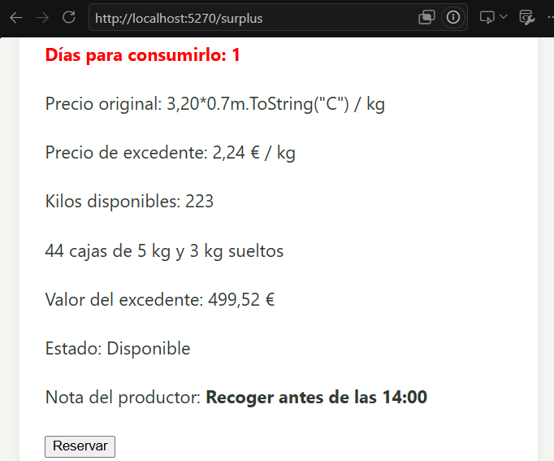
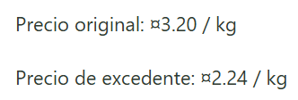
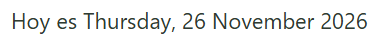
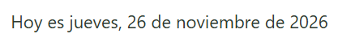

### CUESTIONES UT3

1. **De .cshtml a HTML**

    En NovaHarvest, Surplus.cshtml contiene HTML y expresiones Razor que permiten mostrar datos calculados en el servidor. Al ejecutar dotnet build, Razor genera código C# a partir de las páginas .cshtml, que se compila junto con el resto de la aplicación.

    Cuando un usuario solicita /surplus, ASP.NET Core ejecuta el código correspondiente y devuelve al navegador el HTML generado. Por eso, el navegador recibe HTML y no el código Razor original.

2. **Tecnologías**

    En mi proyecto NovaHarvest, la línea del precio del excedente se escribe de distintas formas según la tecnología utilizada:

    PHP:

    ```PHP
    <p>Precio de excedente: <?= number_format($surplusPrice, 2, ',', '.') ?> €/kg</p>
    ```
    ASP clásico:
    ```
    <p>Precio de excedente: <% Response.Write(surplusPrice) %> €/kg</p>
    ```
    Razor:
    ```
    <p>Precio de excedente: @Model.SurplusPrice.ToString("C") / kg</p>
    ```

    En PHP se utiliza ` <?=?> ` para mostrar el resultado de una expresión, mientras que en ASP clásico se delimita el código con `<% %>`. En Razor se utiliza @ para introducir una expresión C# dentro del HTML.

    En UT2, las páginas se generaban mediante los MapGet de Program.cs, escribiendo el HTML dentro de cadenas de texto en C#. En UT3 he pasado a Razor Pages: cada página tiene su propio archivo .cshtml y la estructura común se encuentra en _Layout.cshtml. Ahora Program.cs utiliza AddRazorPages() y MapRazorPages(), lo que facilita organizar y mantener el código.

    **Program.cs - Actual**

    ```csharp
        var builder = WebApplication.CreateBuilder(args);

        builder.Services.AddRazorPages();

        var app = builder.Build();

        app.UseRequestLocalization("es-ES");

        app.MapStaticAssets();
        app.MapRazorPages();

        app.Run();
    ```
3. **Etiquetas a código**
    
    - Expresión implícita:
    ```HTML
    <h2>@Model.Surplus.Product</h2>
    ```
    HTML generado:
    ```HTML
    <h2>Cereza Picota</h2>
    ```

    - Expresión explicíta:
    ```HTML
        <p>Precio original: @Model.Surplus.PricePerKg.ToString("C") / kg</p>
    ```
    HTML generado:
    ```HTML
    <p>Precio original: 3,20 € / kg</p>
    ```

    - Bloque @{ }
    ```HTML
    @{
    ViewData["Title"] = "Excedente destacado";
    }
    ```

    - @@ 
    ```HTML
    <p>Escríbenos
    a info@novaharvest.es o
    síguenos en @@novaharvest</p>
    ```

    En info@novaharvest.es, Razor reconoce la arroba como parte de una dirección de correo electrónico, por lo que no necesita escaparse.

    En cambio, @novaharvest, al aparecer la arroba seguida de un identificador sin contexto de correo electrónico, puede interpretarse como una expresión de Razor. Por eso se escribe @@novaharvest para que se muestre una sola arroba.

4. **Sintaxis**

    

    

    **¿Por qué no compila?**

    Porque SurplusPrize no existe como propiedad del modelo SurplusModel. C# comprueba que las propiedades utilizadas existen y, al no encontrarla, genera un error de compilación.

    

    

    **¿Por qué sí compila, aunque el resultado esté mal?**

    Porque Razor interpreta como expresión únicamente @Model.Surplus.PricePerKg. El resto, * 0.7m, se considera texto normal y se envía al HTML. Por eso no se calcula el descuento.

    **¿Cómo se corrige?**

    Hay que encerrar toda la operación entre paréntesis para que Razor evalúe la expresión completa.

5. **Efectos en el documento**

    En la página /surplus, la nota del productor contiene `<b>Recoger antes de las 14:00</b>`. En este caso, al utilizar @Html.Raw(Model.Surplus.Note), Razor interpreta el contenido como HTML y el navegador muestra el texto en negrita, en lugar de mostrar las etiquetas. Normalmente, Razor codifica automáticamente los valores para evitar que el HTML introducido se interprete como código. Si utilizáramos @Html.Raw con una nota escrita por un usuario malintencionado, podría introducir código JavaScript y provocar un ataque XSS, ejecutando código en el navegador de otros usuarios. Por eso, Html.Raw debe utilizarse únicamente con contenido HTML de confianza.

    - Elemento dias:
    ```html
    <p class="@(Model.DaysToConsume <= 2 && Model.NewAvailableKg > 0 ? "urgent" : null)">Días para consumirlo:
    @Model.DaysToConsume</p>
    ```

    - Botón reservar
    ```html
     <button type="button" disabled="@(Model.SoldOut ? "disabled" : null)">Reservar</button>
    ```
    Escenario A — Sin cambios

    Días para consumirlo: 5. No necesita la clase urgent.

    

    Escenario C — Producto agotado

    Al reservar los 343 kg, quedan 0 kg disponibles. El botón queda deshabilitado.

    

    Escenario D — Cosecha de hace 6 días

    Queda un día para consumirlo, por lo que se añade la clase urgent.

    

6. **Directivas**

| Directiva o fichero | Comportamiento por defecto que cambia en NovaHarvest |
|---|---|
| `@page` | Convierte un archivo `.cshtml` en una página Razor accesible mediante una ruta URL. |
| `@page "/ticket"` | Define una ruta personalizada para el justificante de reserva, permitiendo acceder mediante `/ticket`. |
| `@model` | Asocia la página con una clase PageModel. Por ejemplo, `/surplus` utiliza `SurplusModel` y `/status` utiliza `StatusModel`. |
| `@using` | Importa espacios de nombres para utilizar sus clases sin escribir el nombre completo. En `_ViewImports.cshtml` importamos `NovaHarvest.Web.Models` y `NovaHarvest.Web.Pages`. |
| `@namespace` | Permite establecer el espacio de nombres de las clases Razor generadas. En nuestro proyecto no aparece esta directiva, por lo que se utiliza el espacio de nombres predeterminado. |
| `@inject` | Permite recibir servicios mediante inyección de dependencias. En `_Layout.cshtml` utilizamos `IWebHostEnvironment Env` para mostrar el entorno de ejecución. |
| `_ViewStart.cshtml` | Establece una configuración común para las páginas. En nuestro caso asigna `_Layout` como diseño predeterminado. |
| `Layout = null` | Desactiva el uso del diseño común. Lo utilizamos en `Ticket.cshtml` para mostrar el justificante sin cabecera, navegación ni pie de página. |


En mi archivo _ViewImports.cshtml no aparece ningún namespace, tengo estos dos using:

- @using NovaHarvest.Web.Models;: permite acceder directamente a las clases del directorio Models, como los modelos de datos de la aplicación.


- @using NovaHarvest.Web.Pages;: permite acceder directamente a las clases PageModel de las páginas, como SurplusModel o StatusModel.

    Están en este fichero para no tener que repetir los mismos @using en cada archivo .cshtml.

    **¿Por qué /reservations/ticket da 404?**

    Porque en Pages/Reservations/Ticket.cshtml he definido expresamente @page "/ticket". Esta ruta personalizada sustituye a la ruta convencional que correspondería a la ubicación del archivo (/Reservations/Ticket). Por tanto, la dirección correcta para acceder al justificante es /ticket, mientras que /reservations/ticket no tiene ninguna página asociada y devuelve un error 404.

7. **Tipos y operadores**

| Dato calculado | Tipo de C# | Operadores utilizados | ¿Por qué se utiliza ese tipo? |
|---|---|---|---|
| NewAvailableKg | int | `-` (resta) | Porque representa kilos enteros disponibles después de las reservas. |
| ConsumeDate | DateTime | `AddDays()` | Porque representa una fecha calculada a partir del día de cosecha. |
| DaysToConsume | int | `-` (resta entre fechas), `.Days` | Porque representa un número entero de días restantes. |
| SurplusPrice | decimal | `*` (multiplicación), `-` (resta) | Porque representa un precio y necesitamos precisión decimal. |
| Boxes | int | `/` (división) | Porque representa el número de cajas completas de 5 kg. |
| RestKg | int | `%` (módulo) | Porque representa los kilos que sobran después de formar las cajas completas. |
| SurplusValue | decimal | `*` (multiplicación) | Porque representa el valor económico total del excedente. |
| Status | string | `==`, `<` y `if / else` | Porque almacena un mensaje que indica si está disponible, agotado o quedan pocos kilos. |
| SoldOut | bool | `==` | Porque solo puede indicar si el excedente está agotado o no. |


**¿Por qué RemainingKg / BoxKg da cajas completas?**

Porque ambos valores son de tipo `int`, por lo que C# realiza una división entera y elimina los decimales.
Si los kilos fueran de tipo `decimal`, el resultado no sería exacto, por lo que habría que utilizar `Math.Floor()` para obtener únicamente las cajas completas.

**¿Qué escribe Razor si mostramos directamente un bool o un null?**

Si mostramos directamente un `bool`, Razor escribe `True` o `False` en el HTML. Si mostramos un `null`, no escribe nada.

8. **Cultura**

    **Precios de /surplus**

    

    No aparecen euros porque los precios y las fechas utilizan la cultura predeterminada del contenedor Linux.

    **Fecha de /**
    
    - Con Docker

        

    - Con dotnet run

        

        La diferencia se debe a que Docker utiliza la cultura predeterminada de su contenedor Linux, que está configurada en inglés, mientras que dotnet run utiliza la cultura de Windows, que en mi caso es español. Por eso las fechas aparecen en idiomas diferentes. UseRequestLocalization("es-ES") fuerza el uso del formato español en ambos entornos.

9. **Ámbito**

    Si sustituimos temporalmente el contador de `/status` por una variable local declarada dentro de un bloque `@{ }` de `Status.cshtml`, al recargar la página el contador vuelve a su valor inicial. Esto ocurre porque una variable local solo existe durante la ejecución de esa página y no conserva su valor entre peticiones.

    ```csharp
    @{
    ViewData["Title"] = "Estado";
    int visits = 0;
    visits++;
    }
    ```

    

    Con `SiteStats`, el contador es compartido entre los navegadores porque está declarado como una variable `static`. Por tanto, si otro navegador entra en `/status`, también verá el contador incrementado. Al ejecutar `docker compose restart backend`, el contador vuelve a cero porque se reinicia el proceso de la aplicación y se pierde el contenido de la memoria.

    

    El layout no puede leer directamente una variable local declarada en `Status.cshtml` porque pertenece a otro ámbito. Para mostrar el título, la página utiliza `ViewData["Title"]`, que permite compartir ese dato con el layout durante la misma petición. En nuestro caso, `Status.cshtml` establece el título "Estado del servidor" y `_Layout.cshtml` lo muestra junto a "NovaHarvest".

10. **PageModel**

    En `SurplusModel.cs` he colocado los datos del excedente, las propiedades calculadas y la lógica que se ejecuta en `OnGet()`. En cambio, en `Surplus.cshtml` he dejado la presentación de la información mediante HTML y Razor. Esta separación permite mantener los cálculos independientes de cómo se muestran en pantalla.

    **Cálculo de kilos disponibles**

    Se realiza en el método `OnGet()` de la siguiente forma:

    ```csharp
    NewAvailableKg = Surplus.AvailableKg - Surplus.ReservedKg;
    ```

    Después, en `Surplus.cshtml`, simplemente muestro el resultado mediante `@Model.NewAvailableKg`

    **Si cargas /surplus tres veces**

    - Se crean **3 objetos SurplusModel**, uno por cada petición. Cada objeto vive durante el procesamiento de su petición y después deja de utilizarse.

    - `SiteStats` es una clase estática, por lo que su contador es compartido y permanece en memoria durante toda la ejecución de la aplicación. No se crea un nuevo contador por cada petición, sino que se incrementa el mismo valor cada vez que se visita `/status`.
