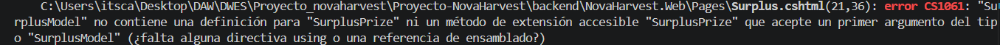
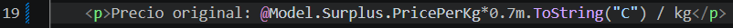
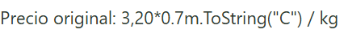

### CUESTIONES UT3

1. **De .cshtml a HTML**

    En NovaHarvest, Surplus.cshtml contiene HTML y expresiones Razor que permiten mostrar datos calculados en el servidor. Al ejecutar dotnet build, Razor genera código C# a partir de las páginas .cshtml, que se compila junto con el resto de la aplicación.

    Cuando un usuario solicita /surplus, ASP.NET Core ejecuta el código correspondiente y devuelve al navegador el HTML generado. Por eso, el navegador recibe HTML y no el código Razor original.

2. **Tecnologías**

    En mi proyecto NovaHarvest, la línea del precio del excedente se escribe de distintas formas según la tecnología utilizada:

    PHP:

    ```PHP
    <p>Precio de excedente: <?= number_format($surplusPrice, 2, ',', '.') ?> €/kg</p>
    ```
    ASP clásico:
    ```
    <p>Precio de excedente: <% Response.Write(surplusPrice) %> €/kg</p>
    ```
    Razor:
    ```
    <p>Precio de excedente: @Model.SurplusPrice.ToString("C") / kg</p>
    ```

    En PHP se utiliza ` <?=?> ` para mostrar el resultado de una expresión, mientras que en ASP clásico se delimita el código con `<% %>`. En Razor se utiliza @ para introducir una expresión C# dentro del HTML.

    En UT2, las páginas se generaban mediante los MapGet de Program.cs, escribiendo el HTML dentro de cadenas de texto en C#. En UT3 he pasado a Razor Pages: cada página tiene su propio archivo .cshtml y la estructura común se encuentra en _Layout.cshtml. Ahora Program.cs utiliza AddRazorPages() y MapRazorPages(), lo que facilita organizar y mantener el código.

    Program.cs - Actual

    ```csharp
        var builder = WebApplication.CreateBuilder(args);

        builder.Services.AddRazorPages();

        var app = builder.Build();

        app.UseRequestLocalization("es-ES");

        app.MapStaticAssets();
        app.MapRazorPages();

        app.Run();
    ```
3. **Etiquetas a código**
    
    - Expresión implícita:
    ```HTML
    <h2>@Model.Surplus.Product</h2>
    ```
    HTML generado:
    ```HTML
    <h2>Cereza Picota</h2>
    ```

    - Expresión explicíta:
    ```HTML
        <p>Precio original: @Model.Surplus.PricePerKg.ToString("C") / kg</p>
    ```
    HTML generado:
    ```HTML
    <p>Precio original: 3,20 € / kg</p>
    ```

    - Bloque @{ }
    ```HTML
    @{
    ViewData["Title"] = "Excedente destacado";
    }
    ```

    - @@ 
    ```HTML
    <p>Escríbenos
    a info@novaharvest.es o
    síguenos en @@novaharvest</p>
    ```

    En info@novaharvest.es, Razor reconoce la arroba como parte de una dirección de correo electrónico, por lo que no necesita escaparse.

    En cambio, @novaharvest, al aparecer la arroba seguida de un identificador sin contexto de correo electrónico, puede interpretarse como una expresión de Razor. Por eso se escribe @@novaharvest para que se muestre una sola arroba.

4. **Sintaxis**

    

    

    ¿Por qué no compila?

    Porque SurplusPrize no existe como propiedad del modelo SurplusModel. C# comprueba que las propiedades utilizadas existen y, al no encontrarla, genera un error de compilación.

    

    

    ¿Por qué sí compila, aunque el resultado esté mal?

    Porque Razor interpreta como expresión únicamente @Model.Surplus.PricePerKg. El resto, * 0.7m, se considera texto normal y se envía al HTML. Por eso no se calcula el descuento.

    ¿Cómo se corrige?

    Hay que encerrar toda la operación entre paréntesis para que Razor evalúe la expresión completa.